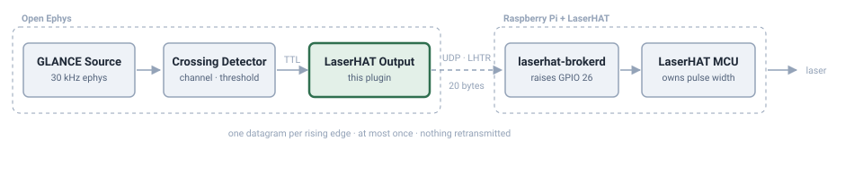

# GLANCE Output

Open Ephys sink plugins for driving hardware from the GLANCE signal chain.

Currently one plugin:

### LaserHAT Output

Sends a UDP trigger to a [LaserHAT](https://github.com/ckemere/LaserDriver) module on every rising
edge of a TTL line. One datagram per edge, straight from the audio thread.

Pulse width and energy belong to the LaserHAT MCU, not to this plugin, so there is
deliberately no pulse-duration control here — the plugin only says *now*.



## Using it

Put any event source upstream. The sink does not care where the event came from:

| upstream | gives you |
| --- | --- |
| [Crossing Detector](https://github.com/open-ephys-plugins/crossing-detector) | channel, threshold, rising/falling, and a lockout (`Timeout`) |
| [Ripple Detector](https://github.com/open-ephys-plugins/ripple-detector) | ripple-band events |
| [Phase Calculator](https://github.com/open-ephys-plugins/phase-calculator) | phase-locked events |

For simple closed-loop stimulation — *cross a threshold on one channel, fire the laser* —
Crossing Detector upstream of this sink is the whole signal chain. Set its channel,
threshold and `Timeout`, point this plugin at the Pi, match the TTL lines, and go.

### Controls

| control | what it does |
| --- | --- |
| **Host** / **Port** | where `laserhat-brokerd` is listening. Names are resolved, so `laserhat.local` works |
| **OPEN** / **CLOSE** | opens the socket. Does *not* prove the Pi is there — UDP never does |
| **PING** | asks the broker to answer without touching the laser. This is the safe way to test the path |
| **Trigger line** | the TTL line that fires, on its rising edge |
| **Gate line** | must be high to allow firing. `0` disables gating |
| **Min interval (ms)** | shortest time between pulses; extra triggers are dropped. `0` = no limit |

The status line shows what the broker last said (`fired`, `duplicate`, `pong`, and any
`MCU busy` / `MCU down` / `simulated GPIO` flag), along with counts and the measured
round trip.

### Why a minimum interval here as well as upstream

Crossing Detector's `Timeout` stops one threshold crossing being counted twice. It knows
nothing about the laser, and it cannot see the other detectors in the chain. **Min
interval** is the laser's own limit: whatever combination of upstream events — or a
stray TTL line — arrives, it caps how hard the laser is driven. Keep both; they are
guarding different things.

It is measured in wall-clock time between datagrams actually sent, not in samples,
because that is what the laser experiences. Every event in one processing block is
handled microseconds apart regardless of how far apart the samples were, so a burst that
looks well spaced in the data can still reach the laser as a burst.

## The protocol

[`Source/LhtrProtocol.h`](Source/LhtrProtocol.h) is the wire format and nothing else — no
JUCE, no sockets. It mirrors `Pi/brokerd/udp_trigger.h` in the LaserDriver repository and
its Python twin `Pi/udp_trigger.py`. **Keep the three in step.**

A 20-byte request, a 36-byte reply, little-endian throughout, at-most-once delivery:
nothing is retransmitted, because a late pulse is worse than a missing one.

This is worth a test precisely because the failure is invisible. A field at the wrong
offset does not crash; the laser just never fires, or fires when it should not.

## Latency

`fire()` is one `send()` on an already connected, non-blocking UDP socket — no name
lookup, no ACK wait, no allocation, no lock. ACKs are collected on a separate thread that
only moves atomic counters for the display, so a Pi that is slow, busy or absent can
never stall acquisition.

What dominates the end-to-end number is not this plugin but the Open Ephys audio callback
that paces the whole graph: at the default 1024 samples / 44.1 kHz that is **23 ms**, and
events are only handled when a block is processed. Lower the buffer size in the GUI's
audio settings if you need to close the loop faster.

Events reach a downstream sink within the *same* callback that generated them, so
splitting detection and output across two plugins costs nothing — the detector's event
and this plugin's `send()` happen in one pass.

## Building

The usual Open Ephys plugin build. Clone next to `plugin-GUI`:

```
  parent/
  ├── plugin-GUI/
  └── OEPlugins/
      └── glance-out-plugin/
```

That nesting is what `GUI_BASE_DIR` defaults to (`../../plugin-GUI`); any folder
name works in place of `OEPlugins`.

```bash
mkdir -p Build && cd Build
cmake -G "Unix Makefiles" -DCMAKE_BUILD_TYPE=Release ..
make && make install
```

Use `-G Xcode` on macOS, `-G "Visual Studio 17 2022" -A x64` on Windows. If plugin-GUI
lives somewhere else, pass `-DGUI_BASE_DIR=/path/to/plugin-GUI`.

## Testing

Neither test needs a Raspberry Pi, a laser, or a built Open Ephys.

```bash
bash test/run_protocol_test.sh [path/to/LaserDriver]    # wire format
bash test/run_loopback_test.sh [path/to/plugin-GUI]     # live socket
```

**`run_protocol_test.sh`** encodes a set of vectors with our encoder and with
`LaserDriver/Pi/udp_trigger.py`, then diffs the bytes, so the two implementations cannot
drift apart silently. It also checks the constants themselves. Needs only a C++ compiler
and `python3`; skips cleanly (exit 2) if LaserDriver isn't checked out nearby.

**`run_loopback_test.sh`** runs the real `LhtrClient` against `test/fake_broker.py` on
localhost — which decodes with the reference `udp_trigger.py` when it can find it. It
covers the parts the wire-format test can't reach: that a host given by *name* resolves,
that `fire()` doesn't block when nothing is listening, that the ACK listener parses
replies, that PING is not treated as a trigger, and that sequence numbers advance so the
broker's duplicate check doesn't swallow the second pulse. It compiles `juce_core` only
(about ten seconds), not the GUI.

## License

GPL-3.0-or-later. See [LICENSE](LICENSE).

---

Part of [GLANCE](https://glanceneuro.org) — open hardware for neural recording.
